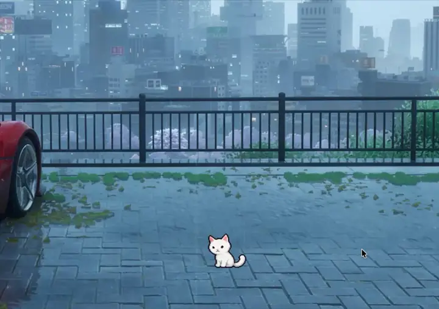

# Whiskumi

A tiny white pixel-art cat that lives on your Mac desktop.

<p align="center">
  
</p>

Whiskumi sits, blinks, grooms, stretches, wanders along the bottom of your screen, naps in
a cardboard box, chases a yarn ball you throw for it, and keeps an eye on your pointer.
Click to pet it, drag to pick it up, double-click for quick care, right-click for everything else.
It's a native AppKit + SwiftUI app with no third-party dependencies.

## Running it

Requirements: macOS 14 Sonoma or later, Xcode 27 or later.

1. Open `Whiskumi/Whiskumi.xcodeproj`.
2. Select the **Whiskumi** scheme and **My Mac** as the destination.
3. Press **⌘R**.

Whiskumi is a menu bar app (no Dock icon). The cat appears near the bottom-right of your main
screen and a cat-head icon appears in the menu bar. To quit, use the menu bar icon (power button
in the popover, or right-click → Quit) or right-click the cat → Quit Whiskumi.

The project signs to run locally (`CODE_SIGN_IDENTITY = -`). To distribute it, set your
development team under *Signing & Capabilities*.

From the command line:

```bash
cd Whiskumi
xcodebuild -scheme Whiskumi -configuration Debug -destination 'platform=macOS' build
xcodebuild test -scheme Whiskumi -destination 'platform=macOS' -only-testing:WhiskumiTests
```

## What it does

**On the desktop**
- Borderless, transparent, non-activating panel: no title bar, never steals keyboard focus,
  hidden from ⌘-Tab / ⌘-\`, optionally on every Space and above full-screen apps.
- Pixel-accurate click-through: clicks on transparent pixels fall through to whatever is below;
  only the cat itself is clickable.
- Crisp pixel art: nearest-neighbour sampling, no mipmaps, no edge antialiasing, and every sprite,
  effect, shadow and the ball laid out on whole device pixels. Effects pop, bob and float in
  whole-pixel steps instead of gliding or scaling. The menu bar preview draws one device pixel per
  art pixel.
- Default size ≈ 85 pt tall (about 170 Retina pixels): 4 device pixels for every 3 art pixels.
  *Pixel Perfect* sizes snap to ratios that nearest-neighbour renders evenly (1:1, 4:3, 3:2, 5:3,
  2:1, …) and never drop below 1:1; *Sharp* uses the exact size; *Smooth* uses plain bilinear
  filtering (still no mipmaps). The size slider runs from 75 % to 300 %.
- Window level: always on top, with other windows, or on the desktop behind all windows.
- Remembers its position per display, survives displays being added, removed or rearranged,
  and keeps itself on-screen.

**Behaviour**
- A cancellable, `async` activity runner: every animation can be interrupted mid-frame by a
  pet, a drag or a menu action, and the cat always gets up naturally first (out of bed, out of the box).
- Weighted random behaviour (35 % idle, 15 % look around, 10 % stretch, 10 % groom, 10 % sit/lie,
  10 % walk, 10 % everything else), reshaped by needs, personality, settings and time of day,
  with recently performed activities damped to avoid repetition.
- Idle life: blinking, slow affectionate blinks, contented smiles, shifting position.
- Walking with direction-flipped sprites, pauses to look around, stops at screen edges;
  occasional zoomies, hops, rolling over, grooming, yawning, meowing, thinking, napping in a box.
- Sleep: yawn → lie down → breathing sleep loop with floating Zs → wake with a stretch or yawn.
- Cursor reactions (all optional and rate-limited): turns to look, gets curious when the pointer
  approaches, bats at a lingering pointer, gets startled by a fast flick, very occasionally chases.

**Interactions**
- **Pet**: click, or stroke back and forth over the cat. Hearts, a happy or heart-eyed pose,
  affection grows. Clicking very fast gets an "enough!" reaction, depending on personality.
- **Pick up**: drag the cat; it follows on a soft spring, dangles wide-eyed (or flies when swung),
  lands where you let go, then composes itself (shake, look around, groom).
- **Double-click**: a compact quick-action bubble (Pet, Feed, Water, Play, Sleep).
- **Right-click**: native context menu with only the actions that make sense right now:
  Pet / Wake Up, Play / Put Ball Away, Feed ▸ (Kibble, Tuna, Salmon Treat), Give Water,
  Let Sleep, Change Behavior ▸ presets and toggles, Settings…, Hide Whiskumi, Quit.
- **Ball**: a yarn ball with its own physics (rolling friction, bounces, quarter-turn rolling).
  Throw it or poke it; Whiskumi notices, runs to it (jumping between ledges if needed), and
  bats it around for a few rounds. Idle balls tidy themselves away.

**Needs & personality**
- Food, water, energy, happiness and affection that drift slowly and never hit zero.
  Time with the app closed counts only partially and is capped; Whiskumi is assumed to nap
  while you're away. No punishments and no guilt.
- Personality traits (playful, lazy, curious, affectionate) shift very gradually with what
  you do together and shape behaviour. Every new kitten starts slightly different.

**Menu bar**: live preview of what the cat is doing right now, mood, need meters,
Pet / Feed / Play / Sleep buttons, Show Whiskumi toggle, Settings and Quit. Right-click the icon
for a compact menu.

**Settings** (toolbar-style window): General, Appearance, Behavior, Sound and Notifications —
launch at login (`SMAppService`), start automatically, menu bar icon, window level, all desktops,
position restore/reset, size, animation speed, rendering quality, effects, default position,
behaviour presets and frequencies, autonomy toggles, personality read-out, sound controls,
gentle reminders. Everything persists immediately.

If the menu bar icon is turned off, open Whiskumi again from Finder/Launchpad or right-click
the cat to reach Settings. The icon comes back by itself whenever the cat is hidden, so you can
never lose Whiskumi.

## Project structure

```
Whiskumi/                         repository root
├── README.md
├── Tools/SpriteExtraction/       reproducible asset pipeline (Python, not shipped)
│   ├── source/                   the supplied sprite sheets and app icon
│   ├── sprite_spec.json          hand-mapped frame rectangles per animation
│   ├── extract_sprites.py        sheets → frames + CatAnimations.json
│   └── make_icons.py             app icon set + menu bar template icon
└── Whiskumi/
    ├── Whiskumi.xcodeproj
    ├── WhiskumiTests/            39 unit tests (Swift Testing)
    ├── WhiskumiUITests/          launch smoke test
    └── Whiskumi/
        ├── App/                  entry point, app delegate, composition root, main menu
        ├── Cat/                  controller, activity scripts, behaviour engine, needs,
        │                         personality, state/mood, interaction handler
        ├── Animation/            sprite library + alpha masks, clip definitions,
        │                         frame player, display-linked frame clock
        ├── Desktop/              transparent panel, renderer view, window/screen/position
        │                         managers, pointer tracker
        ├── Interactions/         petting, drag, feeding, play, ball toy, context menu,
        │                         double-click bubble
        ├── MenuBar/              status item, popover, live preview
        ├── Settings/             settings window and panes
        ├── Audio/                optional sound effects
        ├── Persistence/          settings (UserDefaults) and save file (JSON)
        ├── Services/             launch at login, notifications
        ├── Utilities/            math, logging, DEBUG self-test
        ├── Resources/CatAnimations/   100 extracted frames, 16 effect props, manifest
        └── Assets.xcassets       app icon, menu bar icon
```

## The sprite pipeline

The two supplied sheets use different layouts and are drawn at different scales, so each was
mapped by hand in `sprite_spec.json` (one rectangle per frame, verified against connected-component
analysis). `extract_sprites.py`:

- keeps only the cat's own pixels inside each rectangle — label pills, drawn cursor arrows and
  stray compression specks are dropped;
- lifts effects out of the art as separate *props* (hearts, Zs, "?", "!", thought bubble, meow
  marks, sparkles, dust puffs, the yarn ball) and records exactly where the artist placed them,
  so the app can animate them while keeping the original composition;
- normalises the activities sheet (×1.35, premultiplied Lanczos) to the core sheet's cat size;
- hardens alpha so edges stay crisp on any wallpaper;
- aligns frames within each animation (mask overlap, or the head for leaps) and anchors every
  animation on the head centre and ground line, so poses switch without the cat jumping around.

To regenerate:

```bash
python3 -m venv .venv && .venv/bin/pip install pillow numpy scipy
.venv/bin/python Tools/SpriteExtraction/extract_sprites.py
.venv/bin/python Tools/SpriteExtraction/make_icons.py
```

The *Window Nap* frames (which include a window and background scene) are intentionally unused;
every other supplied animation is in the app. Missing animations fall back to the closest available
pose of the same cat, and activities whose frames are missing are never chosen.

## Sound

No audio ships with Whiskumi, and none is generated. The infrastructure is complete: drop files
into `Whiskumi/Whiskumi/Resources/Sounds/` named after an effect — `meow`, `purr`, `eat`, `drink`,
`sleep`, `play`, `interact` (variants like `meow_2.m4a` are picked at random; `caf`, `wav`, `aiff`,
`m4a` and `mp3` work) — and rebuild. Sound is off by default; the Sound settings explain this until
files are present.

## Testing

- `WhiskumiTests` covers pixel scaling (crisp ratios, device-pixel alignment of every sprite),
  needs decay and offline clamping, personality drift, the behaviour
  distribution and its modifiers, petting gesture recognition, persistence (including corrupt
  files), sprite loading (every animation, frame sizes, anchors, alpha masks, clip frame indices)
  and settings persistence/presets.
- A DEBUG-only end-to-end self-test drives the real app — petting, feeding, water, the ball,
  sleep, a simulated pick-up, every activity and cursor reaction, context menu, double-click
  bubble, menu bar popover, every settings tab, live setting changes, hide/show and saving — and
  renders the app's own windows to PNG. It also verifies that every animation, in both facings and
  while lifted, lands on whole device pixels with nearest-neighbour filtering. It uses throwaway
  settings and a temporary save file, so it never touches your cat:

  ```bash
  Whiskumi.app/Contents/MacOS/Whiskumi -WhiskumiSelfTest /tmp/whiskumi-selftest -WhiskumiSelfTestQuit YES
  ```

## Known limitations

- Whiskumi walks horizontally along the level where it sits (the bottom of the screen by default,
  or wherever you drop it); it doesn't climb onto other apps' windows.
- Eye-tracking of the pointer isn't possible with the supplied art (eyes aren't separate);
  Whiskumi turns to face the pointer instead.
- Launch at login uses `SMAppService`; macOS may ask you to approve it in System Settings → Login
  Items, which the General tab links to.
- Notifications need permission, requested only when you switch them on.
